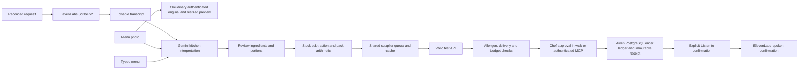

# Valio menu-to-delivery

Turn a chef's menu into a checked purchasing plan, then approve the test order through the kitchen workspace or an authenticated agent.

[Open the kitchen](https://valio.72.61.22.106.sslip.io) · [MCP endpoint](https://valio.72.61.22.106.sslip.io/mcp/) · [Release evidence](artifacts/sponsors/RELEASE-e648c83.md) · [Evaluation notes](eval/README.md)

Built by Shreyansh, team The CS Guy, for Junction 2026's Valio Trusted Trade Agents challenge.

## A kitchen workflow

Open a private Hotel Aurora kitchen. Type a menu, upload its photo or record a request. Review the interpretation, choose guest counts and inspect the proposed order. Valio subtracts kitchen stock, converts quantities into supplier packs and checks allergens, substitutions, delivery cut-offs and spending rules.

The chef approves the exceptions before placing an order. Each visitor gets separate kitchen records and an MCP bearer token. Web and MCP actions use the same checks, including cumulative weekly and monthly spending limits.

Supplier quotes and availability come from Valio's test API. Confirmations are application records. Nothing ships, and no supplier fulfilment endpoint is connected.

## How the services work together



Gemini interprets text and images. ElevenLabs turns recorded speech into editable text before Gemini interprets it. Deterministic code handles quantities, approvals and spending limits. Recording, uploading and speaking a confirmation cannot place an order.

The FastAPI service runs on the VPS. Aiven PostgreSQL holds private kitchens, drafts, orders and budget accounting. A versioned ledger update commits an order and its spending together; competing writers must recheck the latest ledger. Connections use certificate-verified TLS. The current service works with the Mac off.

A shared supplier queue spaces requests and retries temporary failures. Cached supplier responses can be up to 30 minutes old; the UI identifies their age.

## Sponsor integrations in the live release

| Service | Actual use | Verification |
| --- | --- | --- |
| Valio | Product lookup, prices and availability from the challenge test API. | Deployed preparation, approvals and order-record flow. |
| Gemini API | Converts menu text, photos and transcribed requests into kitchen intent for review. | Real deployed voice-to-menu and photo-to-menu flows. |
| Codex | Implementation, debugging, regression tests and deployment verification. | Source, tests and release evidence in this repository. |
| CRACI | Runs the Python regressions and JavaScript syntax check using `runs-on: craci`. | [Successful application-release CI run](https://github.com/13shreyansh/valio-menu-to-delivery/actions/runs/43687469639). |
| Cloudinary | Stores authenticated menu originals, creates a WebP preview limited to 960 × 960, and delivers the signed preview in Ask Valio. Media receipts belong to the private kitchen. | Real upload and transformed-image decode, followed by loaded previews in both production browser flows. |
| ElevenLabs | Scribe v2 transcribes the microphone recording. An explicit **Listen to confirmation** action uses multilingual v2 to speak the recorded order number and total. | Real transcription and returned audio in both production browser flows. |
| Aiven | PostgreSQL stores private kitchen documents, immutable order receipts and the versioned spending ledger. | Real concurrent-write, isolation and migration probes; a newly placed production order remained readable after restarting the application worker. |

Cloudinary's separate hackathon survey remains an administrative requirement. This implementation did not submit that survey. Working integrations alone do not establish prize eligibility or a judging result.

## Run locally

Use Python and Node.js. Supply secrets through the process environment or your deployment's secret manager. Never commit credentials or private kitchen bearer tokens.

```bash
uv venv .venv
uv pip install --python .venv/bin/python -r requirements-dev.txt
npm ci
.venv/bin/python -m uvicorn api.index:app --port 8077
```

| Configuration | Purpose |
| --- | --- |
| `VALIO_API_KEY`, `GEMINI_API_KEY` | Supplier test API and menu interpretation. |
| `AIVEN_DATABASE_URL` | Enables PostgreSQL storage. Use the Aiven service connection URI. |
| `AIVEN_CA_CERT_PATH` | Path to the public CA certificate used with `sslmode=verify-full`. The certificate is public; the database URI is secret. |
| `CLOUDINARY_CLOUD_NAME`, `CLOUDINARY_API_KEY`, `CLOUDINARY_API_SECRET` | Server-side authenticated menu upload and signed preview generation. |
| `ELEVENLABS_API_KEY` | Speech-to-text and confirmation audio. |
| `ELEVENLABS_STT_MODEL`, `ELEVENLABS_TTS_MODEL`, `ELEVENLABS_VOICE_ID` | Optional overrides. Defaults are `scribe_v2`, `eleven_multilingual_v2` and the configured stock voice. |
| `PUBLIC_URL` | Canonical service URL used by connected assistants. |
| `KITCHEN_SIGNING_KEY` | Stable signing identity for kitchen cookies and receipts. Preserve it across deployments. Existing installations can fall back to the supplier key. |
| `AURORA_LOCAL_DB` | SQLite path when Aiven is unset. The default is under `/tmp` and is for development, not durable production storage. |

Without ElevenLabs configuration, recording uses the existing Gemini transcription path; the Listen action requires ElevenLabs. Without Cloudinary, typed input remains available and the photo-storage action reports its unavailable state. Production has all three providers configured. Provider failures report an error without placing an order or changing the spending ledger.

For an existing SQLite installation, `scripts/migrate_aiven.py --apply` imports and verifies documents using a prior-import receipt. A source delta can advance a cloud row only if its version and body still match that receipt. Pause the old writer for the final catch-up. After Aiven accepts new orders, do not switch back to a SQLite-only runtime without reconciling those writes.

## Verification

```bash
.venv/bin/python -m pytest -q
npm run check
```

The sponsor acceptance uses a deployed URL and separate private visitor kitchens at 1440 × 900 and 390 × 844. Supply a local WAV fixture containing a wedding request; credentials stay on the server.

```bash
BASE_URL=https://your-deployed-host \
EXPECTED_COMMIT=your-full-application-commit \
AUDIO_FIXTURE=/absolute/path/to/wedding-request.wav \
OUT=artifacts/e2e/sponsors \
node scripts/sponsor-e2e.cjs
```

The test records audio, checks the ElevenLabs transcript, updates the menu, uploads a photo, waits for its Cloudinary preview, approves the checks, places an application order and plays its spoken confirmation. It then reloads the saved order. `npm run e2e` runs the existing kitchen and request regression flows. Writing tests must use private test kitchens; do not seed repeated orders into the public template.

The production application release is `e648c83cf8f057df9467c4f7cde12f3771c906a6`. Measured results for this release are 94/94 unit tests, two complete production sponsor browser flows with zero page exceptions, and a fresh order read after an actual worker restart. The final SQLite catch-up matched 1596/1596 documents. See [the release record](artifacts/sponsors/RELEASE-e648c83.md) for the scope and evidence.

Pack rounding can still disagree with the supplier's accounting. These tests establish the implemented workflow, not recognition accuracy on a held-out speech or photo dataset. Photo retention and deletion still require a production privacy policy. Signed photo URLs grant access to their holder; keep them and private menus out of public evidence.

## Repository guide

- `api/index.py` starts the service and closes database workers on shutdown.
- `chefagent/portal.py` contains kitchen rules and order commitment; web and MCP share it.
- `chefagent/aiven_store.py` implements PostgreSQL storage and safe migration receipts.
- `chefagent/sponsor_media.py` handles Cloudinary and ElevenLabs.
- `tests/` contains regression checks; `scripts/` contains deployed browser and provider checks.
- [DECISIONS.md](DECISIONS.md) records design choices; [eval/README.md](eval/README.md) describes earlier evaluation work.
