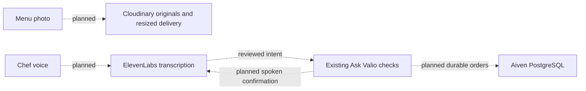

# Valio menu-to-delivery

Turn a chef's menu into a checked purchasing plan, then approve the test order through the kitchen workspace or an authenticated agent.

[Open the kitchen](https://valio.72.61.22.106.sslip.io) · [MCP endpoint](https://valio.72.61.22.106.sslip.io/mcp/) · [Evaluation notes](eval/README.md)

Built by Shreyansh, team The CS Guy, for Junction 2026's Valio Trusted Trade Agents challenge.

## A kitchen workflow

Start a private Hotel Aurora kitchen. Enter a menu by typing, photo or voice, choose guest counts, and review the ingredients the assistant extracted. The application subtracts stock, converts quantities into supplier packs and shows the proposed order.

The chef can inspect allergens, substitutions, delivery cut-offs and spending rules before approval. Each visitor gets a private copy with separate orders and an MCP bearer token. Web and MCP actions apply the same checks, including cumulative weekly and monthly spending limits.

Supplier quotes and availability come from Valio's test API. Order confirmations are application records. Nothing ships, and no supplier fulfilment endpoint is connected.

## Current architecture

```mermaid
flowchart LR
    I[Typed menu, image or voice] --> G[Gemini intake]
    G --> P[Reviewed ingredients and portions]
    P --> R[Stock subtraction and pack arithmetic]
    R --> Q[Shared supplier request queue and cache]
    Q --> V[Valio test API]
    V --> C[Allergen, substitution and budget checks]
    C --> A[Chef approval in web or authenticated MCP]
    A --> D[Private kitchen order store]
```



Gemini interprets input. Deterministic code handles quantities, pack rounding, approvals and spending rules. A shared, spaced supplier queue with retries prevents each visitor from independently hammering the supplier API. Cached supplier responses can be up to 30 minutes old and the UI identifies them.

The current Python/FastAPI service and persistent SQLite storage run on the VPS. The older Vercel URL is not the current demo. The current service does not rely on the Mac.

## Sponsor integrations

| Service | Current state and intended use |
| --- | --- |
| Valio | Implemented. Product lookup, supplier quotes and availability use the test API. Order confirmations are application records; there is no supplier fulfilment endpoint. |
| Gemini API | Implemented. Converts menu text, image and voice input into structured kitchen intent for review. |
| Codex | Used for implementation, debugging and verification. |
| CRACI | **Planned, not implemented.** Run Python tests and frontend checks on CRACI CI. |
| Cloudinary | **Planned, not implemented.** Store the chef's uploaded menu photo and deliver resized images for the intake view. |
| ElevenLabs | **Planned, not implemented.** Transcribe Ask Valio voice input and speak concise confirmations. Existing voice input does not establish ElevenLabs use. |
| Aiven | **Planned, not implemented.** Move private kitchen orders and budget accounting to Aiven PostgreSQL. SQLite is still the current store. |

These planned services have draft prize selections. They are not completed sponsor integrations.

## Run locally

Use Python and Node.js. Supply `VALIO_API_KEY` and `GEMINI_API_KEY` through the process environment. Keep private kitchen bearer tokens out of logs and committed files.

```bash
uv venv .venv
uv pip install --python .venv/bin/python -r requirements-dev.txt
npm ci
.venv/bin/python -m uvicorn api.index:app --port 8077
```

`AURORA_LOCAL_DB` selects the local SQLite file. Its default is under `/tmp`, which is unsuitable for durable production storage. The account store also supports `STORE_URL`, `STORE_KEY` and `STORE_SECRET` for a configured remote store. Do not infer that this alternative is Aiven.

Live supplier paths require the test credentials and reachable supplier service. A fresh visitor kitchen should start clean; do not use another visitor's token or seed repeated test orders into the public starting experience.

## Validation

```bash
.venv/bin/python -m pytest -q
npm run check
```

`npm run e2e` runs browser flow/request checks. Tests that write must use isolated test kitchens and clean up their own data. Do not run shared-account order scripts during recording.

The owner recorded 80/80 unit checks and a stress run with 220 UI steps, 60 Ask requests and 10 browser sessions without failed steps, stale offers, nut leaks or duplicate order numbers. Recorded Ask latency was p50 5.6 seconds and p95 10.3 seconds. These are measured results for that run, not a new independent rerun or a judge score. The current handoff identifies live build `70daa59`.

Pack rounding can still disagree with the supplier's accounting. Test orders never establish real delivery. Inspect the displayed supplier cache age and cut-off before approving a plan.

## Planned architecture and acceptance



Implementation remains pending approval. Cloudinary completion needs an actual upload and transformed delivery URL, plus the sponsor's separate hackathon survey. ElevenLabs needs a real voice round trip while leaving final order approval explicit. Aiven needs durable order reads after restart, transactional budget enforcement and visitor isolation. CRACI needs a successful CI run using `runs-on: craci`.

Do not mark any addition implemented until these checks pass. Photo retention and deletion must follow the kitchen's privacy requirements; order tokens and private menus do not belong in public evidence.

## Repository guide

`api/index.py` starts the web service. `chefagent/` contains kitchen logic, supplier access and the account store. `tests/` holds regression checks; `scripts/` contains browser checks. Read [DECISIONS.md](DECISIONS.md) for design trade-offs and [eval/README.md](eval/README.md) for evaluation context.
